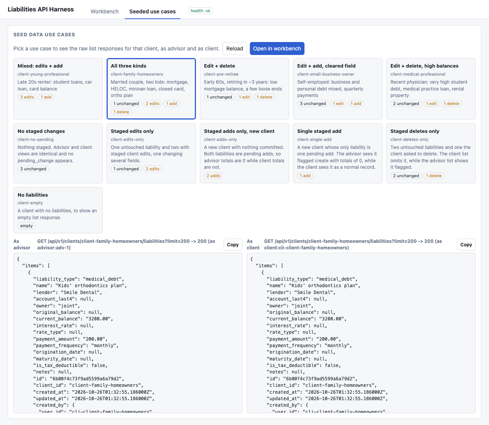
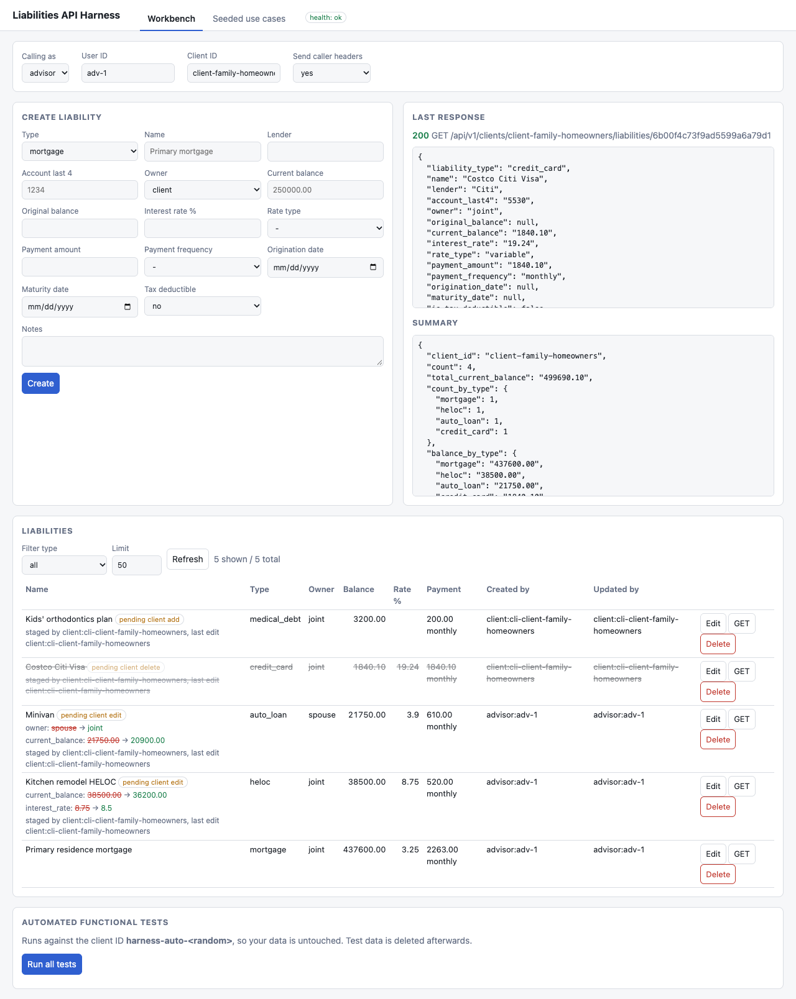

# Client Liabilities API

CRUD API for capturing a client's liabilities, which later feed a financial plan. It is used by both an advisor app and a client app.

**Stack:** FastAPI, Pydantic v2, Beanie (async ODM), MongoDB 8 (docker-compose), uv.

**Java version:** the `java-port` branch contains a Java-based version of this application (`git checkout java-port`).

**Rust version:** the `rust-port` branch contains a Rust-based version of this application (`git checkout rust-port`).

The built-in browser harness lets you poke at the API without writing a single curl command.

**Seeded use cases:** click a card to see the raw API responses for that client, as the advisor and as the client.



**Workbench:** create, edit and delete liabilities for any client. Pending client changes show up inline as field diffs.



## Run

```bash
make install     # uv sync + create .env
make run         # starts MongoDB (docker compose) then the API on :8000
make seed        # load 5 sample client scenarios
make harness     # opens the browser test harness
make fresh       # wipe Mongo (incl. its volume), restart, seed, run the API
```

Docs: http://localhost:8000/docs. Run `make help` to list every target (`up`, `down`, `logs`, `test`, `lint`, `format`, `check`, `reset-db`, `fresh`, `clean`).

## Sample data

`make seed` loads 11 sample clients (re-runnable; it replaces their existing records). Each one is a use case, and the harness lists them with descriptions (`GET /api/v1/seed-scenarios`).

| Client ID | Use case | Liabilities | Staged |
|---|---|---|---|
| `client-no-pending` | No staged changes | 3 | none |
| `client-edits-only` | Staged edits only | 3 | 2 edits |
| `client-adds-only` | Staged adds only, new client | 2 | 2 adds |
| `client-single-add` | Single staged add | 1 | 1 add |
| `client-deletes-only` | Staged deletes only | 3 | 1 delete |
| `client-empty` | No liabilities | 0 | none |
| `client-young-professional` | Mixed: edits + add | 4 | 3 edits, 1 add |
| `client-family-homeowners` | All three kinds | 5 | 2 edits, 1 add, 1 delete |
| `client-pre-retiree` | Edit + delete | 3 | 1 edit, 1 delete |
| `client-small-business-owner` | Edit + add, cleared field | 5 | 1 edit, 1 add |
| `client-medical-professional` | Edit + delete, high balances | 4 | 1 edit, 1 delete |

See [docs/use-cases.md](docs/use-cases.md) for each use case's `GET` response as the advisor and as the client, side by side.

## Test harness

`harness/index.html` is a plain HTML/JS page that the API serves at http://localhost:8000/harness/ (same origin, so no CORS setup). It has two tabs, and the active one is kept in the URL hash (`#workbench` or `#scenarios`).

**Seeded use cases** tab:

- A card for each seed use case, with its description and counts. Selecting one shows the raw JSON from `GET .../liabilities`, once as an advisor and once as the client. This does not change anything on the Workbench tab.
- An **Open in workbench** button that loads the selected client into the Workbench tab.

**Workbench** tab:

- A caller switcher (advisor or client, plus user ID and client ID) that sets the `X-Caller-Type` and `X-User-Id` headers. You can also turn the headers off to check that the API returns 422.
- A create/edit form, a filterable list and a summary panel.
- A response panel showing the status and body of the last request.
- An **Automated functional tests** button. It runs 27 checks against a throwaway client ID and cleans up afterwards. The checks cover CRUD, audit stamps, filtering and paging, staged client edits, adds and deletes, the summary, client isolation, header validation and field validation.

The browser console shows a few 4xx errors during that run. They come from the negative tests that expect a 422 or 404.

## Identifying the caller

Every request, reads included, requires two headers. The API records them as audit stamps (`created_by`, `updated_by`) and uses the caller type to decide whether an edit is staged (see below). Both callers have the same access.

| Header | Value |
|---|---|
| `X-Caller-Type` | `advisor` or `client` |
| `X-User-Id` | the calling user's ID |

A missing or invalid header returns 422. These headers are not authenticated, so they suit a local demo only.

## Staged client changes

A client's edits, adds and deletes are staged so an advisor can review them before they change the main record. Review and accept/reject are not built yet. Each staged change has an `action`: `update`, `create` or `delete`.

| Caller | Action | Effect | What each side sees |
|---|---|---|---|
| advisor | PATCH, POST, DELETE | Applied immediately. A PATCH drops any staged client fields it overlaps. DELETE is a hard delete. | Committed data, plus `pending_change` when the client has something staged |
| client | PATCH | Staged (`update`). Repeated PATCHes merge into one staged change. Setting a field back to its committed value un-stages it. | Client: committed data merged with the staged edits, no change info. Advisor: committed data plus a field diff |
| client | POST | The record is created and flagged `create` | The client sees it as a normal record. The advisor sees it flagged `create`, and the advisor's summary leaves it out until it is accepted |
| client | PATCH on a pending add | Edits the record directly; the flag stays | Same as above |
| client | DELETE | Staged (`delete`), and any staged edits are discarded | The client no longer sees it (GET, PATCH and DELETE return 404, and it is out of the list and summary). The advisor sees the committed record flagged `delete`, still counted in totals |
| client | DELETE of a pending add | Hard delete, since nothing was committed | Gone for both |

**Clients only ever get their updated view**: staged edits merged over the committed data, pending adds included, pending deletes left out. Client responses carry no `pending_change` key at all.

Advisors get `pending_change` (`changes` is only filled for `update`):

```json
{
  "action": "update",
  "changes": {"current_balance": {"current": "1840.10", "proposed": "920.00"}},
  "created_by": {"user_id": "cli-1", "caller_type": "client", "at": "..."},
  "updated_by": {"user_id": "cli-1", "caller_type": "client", "at": "..."}
}
```

The advisor's summary has `pending_change_count` and `pending_by_action`; a client's summary reports 0 and `{}`. Its totals use the client's view for a client caller (pending adds in, pending deletes out) and committed data for an advisor (pending adds out, pending deletes in).

### Advisor vs client views

Same record, same `GET /api/v1/clients/client-edits-only/liabilities`, different caller. The client staged a lower balance on "Travel Amex" (shortened here):

<table>
<tr><th>Advisor GET</th><th>Client GET</th></tr>
<tr>
<td valign="top">

```json
{
  "name": "Travel Amex",
  "liability_type": "credit_card",
  "current_balance": "4200.00",
  "...": "other fields omitted",
  "pending_change": {
    "action": "update",
    "changes": {
      "current_balance": {
        "current": "4200.00",
        "proposed": "3500.00"
      }
    },
    "created_by": {"user_id": "cli-client-edits-only", "caller_type": "client", "at": "..."},
    "updated_by": {"user_id": "cli-client-edits-only", "caller_type": "client", "at": "..."}
  }
}
```

</td>
<td valign="top">

```json
{
  "name": "Travel Amex",
  "liability_type": "credit_card",
  "current_balance": "3500.00",
  "...": "other fields omitted"
}
```

</td>
</tr>
</table>

[docs/use-cases.md](docs/use-cases.md) has the full, unabridged GET response for every seed use case, advisor and client side by side. IDs and timestamps in it come from one seed run, so yours will differ.

## Endpoints (`/api/v1/clients/{client_id}/liabilities`)

| Method | Path | Description |
|---|---|---|
| POST | `` | Create (201) |
| GET | `` | List. Query params: `liability_type`, `skip`, `limit` |
| GET | `/summary` | Totals by type and annualized payments |
| GET | `/{id}` | Read one |
| PATCH | `/{id}` | Partial update (staged when the caller is a client) |
| DELETE | `/{id}` | Hard delete for an advisor; staged for a client (204) |

Also: `GET /health` and `GET /api/v1/seed-scenarios` (static seed use-case metadata for the harness; no caller headers needed). Money fields are decimal strings (stored as Decimal128).

```bash
curl -X POST localhost:8000/api/v1/clients/c1/liabilities \
  -H 'X-Caller-Type: advisor' -H 'X-User-Id: adv-1' -H 'content-type: application/json' \
  -d '{"liability_type":"mortgage","name":"Primary mortgage","current_balance":"250000.00"}'
```

## Develop

```bash
make test        # pytest against the Mongo container (`liabilities_test` DB)
make check       # ruff lint + format check + tests
make format      # auto-fix and format
```
